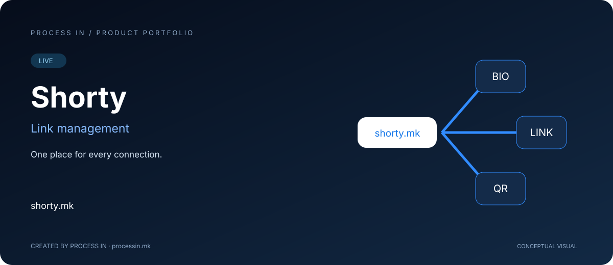

# Shorty

[Македонски](README.mk.md) · [English](README.md) · [Shqip](README.sq.md) · [Türkçe](README.tr.md)

**Një vend për çdo lidhje.**

**LIVE**

## Produkti

Shorty bashkon lidhjet e shkurtra, faqet bio dhe kodet QR në një platformë menaxhimi lidhjesh. Faqja zyrtare paraqet edhe organizimin e fushatave, analitikën dhe një ndihmës AI për punën me lidhje. Disa pjesë të ndërfaqes përdorin emrin ShortURL; prezantimi ndjek emrin aktual Shorty të konfirmuar në regjistër.

## Nga lidhja e ndarë te destinacioni i menaxhuar

Fushata mund të ketë lidhje në email, profile sociale, materiale të shtypura dhe kode QR. Sfida është t'i mbajë destinacionet të kuptueshme dhe të organizuara pas shpërndarjes.

Shorty bashkon URL-në e shkurtër, faqen bio dhe QR-në në të njëjtin kontekst. Krijuesi mbledh destinacionet kryesore në një faqe bio. Biznesi vendos QR në menu ose poster dhe menaxhon destinacionin. Ekipi i marketingut organizon burimet e fushatës dhe shqyrton klikimet ose skanimet.

### Pse ka rëndësi

Vlera shkon përtej shkurtimit: adresa e dallueshme përmirëson paraqitjen, faqja bio bashkon destinacionet dhe QR-të dinamike lejojnë ndryshim pa rishtypje. Analitika ndihmon shqyrtimin e përdorimit.

Para nisjes, vendosni ku duhet të arrijë vizitori, si do të shpërndahet lidhja dhe çfarë dëshironi të mësoni.

## Si funksionon

| Hapi | Veprimi |
|---|---|
| 1 | Zgjidhni lidhje, faqe bio ose QR |
| 2 | Përgatitni destinacionin dhe markën |
| 3 | Ndani burimin |
| 4 | Shqyrtoni klikimet ose skanimet në analitikë |

## Mundësitë kryesore

| Fusha | Mundësitë |
|---|---|
| **Lidhjet e shkurtra** | URL kompakte dhe të dallueshme. |
| **Faqet bio** | Destinacionet e rëndësishme së bashku. |
| **QR dinamike** | Ndryshim destinacioni pa rishtypje. |
| **Analitika** | Klikime, vendndodhje dhe pajisje. |
| **Fushatat** | Organizim i lidhjeve dhe burimeve QR. |
| **Ndihmësi AI** | Ndihmë me emërtimet URL, faqet bio dhe analizat. |
| **Kontrollet e lidhjes** | Faqja paraqet fjalëkalim dhe skadim. |
| **Hapësirat e ekipit** | Organizim i përbashkët me qasje sipas rolit. |

## Për kë është

Për marketing, krijues, agjenci dhe organizata që lidhin materialet fizike me destinacionet online.

## Skenar praktik

Një ambient shtyp QR dinamike për faqe informacioni dhe përditëson destinacionin kur ndryshon fushata. Krijuesi mbledh lidhjet kryesore në një faqe bio.

## Përvoja e produktit

Ilustrimi është konceptual, jo pamje e aplikacionit. Faqja zyrtare ofron ndërfaqen, opsionet dhe kushtet aktuale.

## Informacion për produktin

| Hollësia | Vlera |
|---|---|
| Domeni | [shorty.mk](https://shorty.mk/) |
| Kategoria | Menaxhim lidhjesh dhe kodesh QR |
| Statusi | LIVE |
| Zhvilluesi | [PROCESS IN](https://processin.mk) |
| Kontakti i portofolit | [contact@processin.mk](mailto:contact@processin.mk) |

Burimi: [Faqja zyrtare](https://shorty.mk/).

### [Vizitoni Shorty](https://shorty.mk/)

[PROCESS IN — Your Enterprise Software & AI Partner](https://processin.mk)

---

Prezantim publik i produktit. Pa kod privat, të dhëna klientësh ose sekrete prodhimi. Nuk jepet licencë me burim të hapur për produktin.

---

This platform is a digital product of <a href="https://processin.mk" target="_blank" >PROCESS IN </a>· Your Enterprise Software & AI Partner ·  Hosted on Enterprise Infrastructure by <a href="https://inhost.mk" target="_blank">INHOST</a>·
